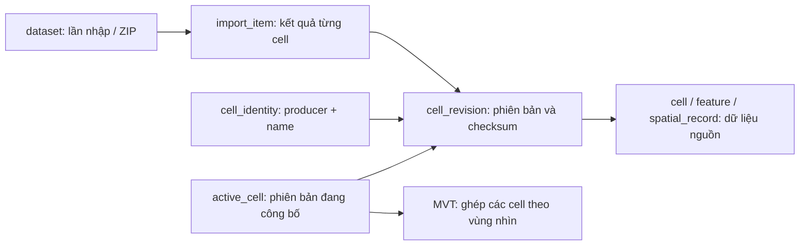

# Kho ENC chung — giai đoạn 1

## Hợp đồng

- `/api/enc/cells` và `/api/enc/tiles/{z}/{x}/{y}.pbf` không có `dataset`
  đọc tất cả cell đang công bố. Chỉ một phiên bản cho mỗi `(producer, cell_name)`.
- `?dataset=<uuid>` là bộ lọc lần nhập, dùng kiểm tra cả bản cũ hoặc xung đột.
  Bộ lọc này không thay đổi danh mục đang công bố.
- `/api/enc/datasets` vẫn là API tương thích cho các lần nhập, trả thêm
  `catalogRevision` và thống kê `outcomes` theo từng lần nhập.
- Cell trả thêm `description`, `producer`, `revisionId`; mô tả lấy từ
  `CATALOG.031`, không suy diễn tên region từ tên ZIP.

## Mô hình



`dataset` giữ vai trò import batch để tương thích API hiện có. `cell_revision`
trỏ tới kho geometry hiện tại bằng `storage_dataset_id`; việc chia sẻ bản trùng
không nhân bản feature. Khóa ngoại bảo vệ kho geometry khi vẫn có người tham chiếu.

## Quy tắc

1. Hash nội dung các file `.000` và chuỗi update theo thứ tự, độc lập đường dẫn ZIP.
2. Cùng producer, tên cell và checksum: dùng lại revision, kết quả `duplicate`.
3. Bản chưa có: lưu revision; đọc edition từ base để tránh update ghi đè edition.
4. Cùng edition/update nhưng khác nội dung: giữ revision `conflict`, không tự công bố.
5. Bản cũ hơn được giữ với kết quả `older`. Bản đồ chọn edition/update lớn nhất
   trong các revision được chấp nhận và còn lần nhập ready tham chiếu.
6. Việc đăng ký/công bố và xóa lần nhập dùng chung advisory transaction lock.
   Job vẫn công bố nguyên ZIP trong một transaction; lỗi đọc cell làm rollback ZIP.
7. Xóa lần nhập gỡ tham chiếu, tính lại phiên bản hoạt động và xóa revision không
   còn được dùng. Kho dữ liệu còn được lần nhập khác sử dụng được giữ lại.

Tile có `revision` trong URL để MapLibre tải lại khi catalog đổi. HTTP tile tạm
thời dùng `no-store`; tối ưu cache thuộc giai đoạn 2. UI theo dõi catalog và
giữ camera khi dữ liệu cập nhật.

## Nâng cấp dữ liệu cũ

Từ thư mục gốc:

```powershell
docker compose -f infra/compose.yaml run --rm --no-deps enc-migrate
docker compose -f infra/compose.yaml --profile enc up -d --build --no-deps enc-import-worker
docker exec map-service-enc-import-worker-1 python3 /app/worker.py --backfill-catalog
```

Migration `07-enc-catalog.sql` thêm các bảng và đưa cell cũ vào danh mục chung.
Backfill đọc ZIP được giữ lại, kiểm tra checksum, bổ sung tên và checksum cell,
gom các revision trùng về một bản dùng chung. Không cần chạy GDAL để nhập lại
geometry. ZIP không còn trên đĩa được báo trong log; metadata cũ vẫn sử dụng được.
Các hàng geometry trùng từ trước nâng cấp được giữ để tránh xóa dữ liệu cũ;
những lần nhập mới trùng nội dung dùng chung kho geometry ngay từ đầu.

Region, workspace chỉnh sửa, duyệt xung đột và xuất S-57 chưa thuộc giai đoạn này.

Các bổ sung sau giai đoạn 1 được theo dõi trong [ROADMAP.md](ROADMAP.md).
